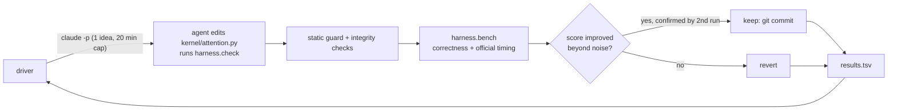

# GQA flash-attention, optimized by an agent loop

A Triton forward-pass kernel for grouped-query attention (32 query heads, 8 KV heads, head_dim 128, bf16, batch 1),
optimized on a single RTX 5090 by a Karpathy-style [autoresearch](https://github.com/karpathy/autoresearch) loop:
headless Claude Code (`claude-opus-5-5`, effort `high`) proposes one idea per invocation, a driver measures it, and
only verified improvements are kept. The loop ran for 6 active hours (52 experiments). The results block is generated
from the run's own logs and a fresh final benchmark.

**Headline: the agent's kernel, precision-matched to FA2, is 1.04×–1.49× faster than FlashAttention-2 on every row
(geomean 1.17×).** The loop first beat FA2 on every row after 5 experiments and 11 active minutes.

Workloads: prefill (causal, seq_q = seq_kv in 2048..32768) and decode (seq_q = 1, seq_kv in 2048..65536), 11 table
shapes in total. Baselines are FlashAttention-2 and PyTorch SDPA.

## Hardware

RTX 5090 (consumer Blackwell, `sm_120`), from `results/device.json`: 170 SMs, 96 MiB L2, about 99 KB of shared memory
per block (101,376 bytes opt-in), 32 GB of memory.

FA2 is the baseline because it is the strongest attention kernel that actually runs on this card: FlashAttention-3 is
Hopper-only and FlashAttention-4 reportedly does not run on `sm_120` ([source](https://gist.github.com/solatticus/aab6ec3a0436748b021cbbdd12e8c739)). FA2 here is `flash-attn==2.8.3.post2`, built from source for
`sm_120`.

## How the loop works



One experiment is one idea, one `claude -p` invocation, and one official benchmark run by the driver. The score is the
geometric mean over the 11 table shapes of `fa2_ms / ours_ms`. Guardrails:

- Locked harness: `harness/**/*.py`, `program.md`, `pyproject.toml` and `uv.lock` are hashed at loop start and a change stops the loop; the driver files are protected separately by the per-experiment change check (`check_agent_changes`).
- Tool allow-list under `dontAsk`: the agent can edit only `kernel/attention.py`, `notes.md` and `experiments/current.json`.
- Correctness gate: every table shape plus 4 held-out shapes the agent never sees on the table (odd lengths, group size 8
  and 1), with a per-row relative-error check. Any failure disqualifies the experiment.
- No timing access: the agent can check correctness and profile, but official timing runs only in the driver.
- Timing-integrity check: the benchmark snapshots and verifies that timing and baseline code were not tampered with.
- Static kernel guard: no inline PTX/asm, no CUDA/C++ extensions, no banned builtins or writes outside the allow-list,
  and no way around Triton: torch attention/matmul/softmax ops, SDPA, `torch.ops`, FlashAttention, CUDA streams,
  CUDA graphs and `data_ptr`-keyed caches are rejected.
- Freshness and Triton-only checks in the official benchmark: after timing each shape, the benchmark refills the same
  q/k/v tensors in place with new random data, calls the kernel once under `torch.profiler` and requires (a) a match
  with a fresh fp32 reference and (b) that every CUDA kernel launched was launched through Triton (torch's own
  fill/copy kernels from allocation are allowed). This rules out cached outputs and delegating to cuBLAS/FA/SDPA.
- Idle GPU: before every official benchmark the driver kills its own leftover `harness.check`/`harness.profile`/`ncu`
  processes and waits up to 60 s for any other compute app; if the GPU is still busy the experiment is recorded as
  `crashed` ("gpu busy") rather than timed.
- Two-run confirmation: an apparent win must beat the noise threshold and reproduce on a second run before it is kept.

Active time is wall time minus pauses (usage limits, error back-off, driver offline). If the driver is killed and
restarted, the time since its last heartbeat before the kill is counted as paused, so active time is slightly
under-counted across restarts.

## Results

<!-- RESULTS:START -->
**Ours vs FA2: 1.04×–1.49× (geomean 1.17×); vs PyTorch SDPA: 1.05×–1.49×** across the 11 table shapes (>1 means ours is faster).

| Workload | seq_kv | ours (ms) | FA2 (ms) | SDPA (ms) | vs FA2 | vs SDPA |
|---|---:|---:|---:|---:|---:|---:|
| Prefill | 2048 | 0.194 | 0.244 | 0.249 | **1.26×** | **1.28×** |
| Prefill | 4096 | 0.651 | 0.788 | 0.805 | **1.21×** | **1.24×** |
| Prefill | 8192 | 2.495 | 2.794 | 2.840 | **1.12×** | **1.14×** |
| Prefill | 16384 | 9.787 | 10.479 | 10.647 | **1.07×** | **1.09×** |
| Prefill | 32768 | 38.816 | 40.549 | 41.199 | **1.04×** | **1.06×** |
| Decode | 2048 | 0.013 | 0.019 | 0.019 | **1.49×** | **1.49×** |
| Decode | 4096 | 0.018 | 0.027 | 0.027 | **1.48×** | **1.48×** |
| Decode | 8192 | 0.031 | 0.037 | 0.037 | **1.20×** | **1.20×** |
| Decode | 16384 | 0.054 | 0.058 | 0.059 | **1.08×** | **1.10×** |
| Decode | 32768 | 0.096 | 0.100 | 0.100 | **1.05×** | **1.05×** |
| Decode | 65536 | 0.176 | 0.183 | 0.187 | **1.04×** | **1.06×** |

SDPA backend: on this card SDPA's default dispatch runs the `flash` backend (PyTorch built-in flash kernel), recorded per shape in `results/final.json`. SDPA is called with `enable_gqa=True`.

**Accounting**

- Experiments: 52 total (13 kept, 38 reverted, 0 failed correctness, 1 other: crash/violation/timeout/agent error). The seed (exp 0), usage-limit pauses and 0 agent error(s) before any work (no hypothesis, zero output tokens; retried) are not counted as experiments.
- Score (geomean FA2 ms / ours ms): seed 0.269, final best 1.350
- Time to beat FA2 on every row: exp 5, 0h 11m active, 0h 11m wall (first kept experiment with every row >= 1.0x the cached FA2 baselines)
- Time to reach the best kernel: 5h 31m active, 18h 59m wall (at the last kept experiment)
- Active time: 6h 12m; wall time: 23h 30m; 5 usage-limit pause(s), 17h 18m paused in total
- Stop reason: active_hours
- Loop tokens (agent invocations, exact per-session totals from Claude result events): input 1,268, output 1,794,265, cache read 49,109,082, cache write 5,004,989; total 55,909,604. 1 experiment(s) hit the 20-minute timeout and report no result event, so loop tokens are a lower bound.
- Build tokens (interactive sessions plus subagents that built the harness and driver, from local transcripts): input 1,646, output 683,292, cache read 77,599,929, cache write 3,076,132; total 81,360,999; span 2026-11-06T22:48Z to 2026-11-09T19:21Z
<!-- RESULTS:END -->

**Which kernel is in the table.** The table above times `kernel/attention_fp32acc.py`: the agent's final kernel
with one change made by hand after the run. Three kept experiments (12, 13 and 15) switched the prefill matmuls to
fp16 inputs with fp16 accumulation. GeForce cards run that mode at about twice the fp32-accumulate rate, but FA2
accumulates in fp32, so that would not be a like-for-like comparison. The precision-matched kernel removes only those
three changes (bf16 inputs, fp32 accumulation, like FA2) and keeps everything else the agent found. It passes the same
correctness gate, held-out shapes, freshness check and static guard. The accounting lines above (score 1.350, time to
reach the best kernel) describe the loop itself, whose best kernel used fp16 accumulation.

**The fp16-accumulate kernel (not the headline).** The agent's unmodified final kernel, `kernel/attention.py`,
benchmarks at 1.04×–1.74× FA2 (geomean 1.35×; `results/final_fp16acc.json`). It passes the
harness correctness gate, which uses random normal inputs. A separate stress test with larger values
(`scripts/precision_stress.py`, prefill 4096) shows where it breaks:

| Inputs | fp16-accumulate kernel | precision-matched kernel | FA2 |
|---|---:|---:|---:|
| harness inputs: randn | 0.23% | 0.22% | 0.22% |
| q and k x8 | 12.33% | 0.30% | 0.30% |
| q and k x16 | 39.18% | 0.30% | 0.30% |
| v x100 | 0.25% | 0.25% | 0.25% |
| v x1000 | 0.25% | 0.23% | 0.23% |
| one k channel x100 (LLM-style outlier) | 4.98% | 0.36% | 0.36% |
| one k channel x1000 | 22.12% | 0.36% | 0.36% |

Error is max |out − fp32 reference| / max |fp32 reference|. With larger q·k values or one outlier channel in K
(common in real LLM activations), fp16 accumulation gives errors of 5–39%, while the precision-matched kernel
matches FA2's error. So the 1.35× figure only holds for well-scaled inputs, and it is not the claim this repo makes.


The plot shows the loop's own score, including the fp16-accumulate experiments.

## What worked / what didn't

52 experiments: 13 kept, 38 reverted, 1 timeout, 0 correctness failures, 0 guard violations. Every row is in
`results.tsv`, with the agent's reasoning in `notes.md`.

**Kept** (loop score, geomean vs FA2, after each experiment):

| Exp | Idea | Score |
|---|---|---:|
| 0 | Seed: plain Triton flash attention | 0.269 |
| 1 | Split-KV (flash-decoding) for decode, sized to about 4 CTAs per SM | 0.618 |
| 2 | Causal block skipping in prefill (unmasked off-diagonal loop + masked diagonal) | 0.791 |
| 3 | Autotuned prefill tiles, warps and stages | 0.922 |
| 4 | GQA packing in decode: the 4 query heads sharing a KV head read each K/V tile once | 1.054 |
| 5 | exp2 softmax with log2(e) folded into the scale (first time every row ≥ 1.0× FA2) | 1.101 |
| 6 | Heaviest-first launch order for causal prefill (longest KV prefix first, heads fastest) | 1.152 |
| 12, 13, 15 | fp16-accumulate P·V and Q·Kᵀ, K/V pre-converted to fp16 (removed from the headline kernel, see above) | 1.185, 1.209, 1.308 |
| 21 | L2 evict-first loads for the streamed K/V in decode | 1.327 |
| 34, 44 | A 128×128 prefill tile, then picking it deterministically for long prefill | 1.330, 1.342 |
| 48 | Split-KV combine fused into the decode kernel for short decodes (last CTA combines) | 1.351 |

**Didn't work** (highlights of the 38 reverted experiments: slower, or a gain inside the noise band that did
not reproduce; all of them are in `results.tsv`):

- Software pipelining the prefill loop by hand, several variants (exps 16, 35, 36, 37): no gain beyond noise; Triton's
  own pipeliner already overlaps loads and math.
- TMA tensor-descriptor loads in prefill (exp 33): slower.
- FA4-style partial software exp2 (exp 29) and splitting P·V along head_dim (exps 24, 40): slower or no gain.
- Decode split-count and wave-sizing policies (exps 8, 10, 17, 22, 30, 31, 43): within noise. Exp 8 won its first run
  but not the confirmation run.
- Packing more KV heads per decode CTA (exps 23, 39): slower.
- Compile-time strides (exps 41, 45, 51): small first-run wins that did not reproduce.
- In-kernel combine for long decodes: a 2-level arrival tree (exps 49, 50) did not beat the separate combine kernel,
  and a resident polling-combine design (exp 46) hit the 20-minute timeout.

**Caveats**

- The precision-matched kernel is a hand edit after the run, not a loop output. Its later tile choices (exps 34 and
  44) were tuned while the kernel used fp16 accumulation, so it may be leaving some speed on the table.
- The decode kernel's fused combine (exp 48) uses arrival counters that persist between calls. Two concurrent calls on
  different CUDA streams would share them. This does not affect these benchmarks, but a production version should
  allocate counters per stream.
- Synthetic random inputs, batch 1, one GPU. Margins on the longest rows are 4–5%.

## Prior art

- [tonbistudio/gqa-flash-attn-rtx3060](https://github.com/tonbistudio/gqa-flash-attn-rtx3060): GQA flash-attention work on a consumer GPU.
- [fastflash-attention](https://pypi.org/project/fastflash-attention/) on PyPI.
- [karpathy/autoresearch](https://github.com/karpathy/autoresearch): the agent-in-a-loop research setup this repo follows.

## Reproduce

```bash
# environment (never `uv sync`: flash-attn must be built from source for sm_120, see the comment in pyproject.toml)
uv sync --no-install-package flash-attn
FLASH_ATTN_CUDA_ARCHS=120 NVCC_THREADS=2 MAX_JOBS=6 CUDA_HOME=/usr/local/cuda-12.8 TORCH_CUDA_ARCH_LIST=12.0 \
  PATH=/usr/local/cuda-12.8/bin:$PATH uv pip install flash-attn==2.8.3.post2 --no-build-isolation

uv run --frozen pytest                          # all tests (GPU tests are marked `gpu` and skip without CUDA)
./run_loop.sh                                   # the autoresearch loop (status lines -> progress.log)
nohup ./run_loop.sh > driver.out 2>&1 &         # unattended

uv run --frozen python -m scripts.token_report  # -> results/token_report.json
uv run --frozen python -m scripts.final_report  # fresh bench of all three kernels, rewrites the table above
uv run --frozen python -m scripts.plot_progress # -> results/progress.png
uv run --frozen python -m scripts.precision_stress  # large-value stress test -> results/precision_stress.json
```

`token_report` reads Claude Code transcripts from `~/.claude/projects/`, so it only reproduces on the machine that ran
the build and the loop.

## Next steps

- Re-run the loop with the large-value stress cases in the correctness gate, so the agent optimizes the
  precision-matched kernel directly instead of finding fp16 accumulation.

- FP8 K/V cache for decode (bandwidth-bound).
- TMA loads on `sm_120`, if Triton exposes them.
- Warp specialization.
- Per-shape autotune caching.
