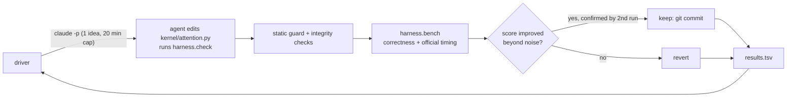

# GQA flash-attention, optimized by an agent loop

A Triton forward-pass kernel for grouped-query attention (32 query heads, 8 KV heads, head_dim 128, bf16, batch 1),
optimized on a single RTX 5090 by a Karpathy-style [autoresearch](https://github.com/karpathy/autoresearch) loop:
headless Claude Code (`claude-opus-5-5`, effort `high`) proposes one idea per invocation, a driver measures it, and
only verified improvements are kept. The loop runs for up to 12 active hours. Everything below the results table is
generated from the run's own logs.

Workloads: prefill (causal, seq_q = seq_kv in 2048..32768) and decode (seq_q = 1, seq_kv in 2048..65536), 11 table
shapes in total. Baselines are FlashAttention-2 and PyTorch SDPA.

## Hardware

RTX 5090 (consumer Blackwell, `sm_120`), from `results/device.json`: 170 SMs, 96 MiB L2, about 99 KB of shared memory
per block (101,376 bytes opt-in), 32 GB of memory.

FA2 is the baseline because it is the strongest attention kernel that actually runs on this card: FlashAttention-3 is
Hopper-only and FlashAttention-4 reportedly does not run on `sm_120` ([source](https://gist.github.com/solatticus/aab6ec3a0436748b021cbbdd12e8c739)). FA2 here is `flash-attn==2.8.3.post2`, built from source for
`sm_120`.

## How the loop works



One experiment is one idea, one `claude -p` invocation, and one official benchmark run by the driver. The score is the
geometric mean over the 11 table shapes of `fa2_ms / ours_ms`. Guardrails:

- Locked harness: `harness/**/*.py`, `program.md`, `pyproject.toml` and `uv.lock` are hashed at loop start and a change stops the loop; the driver files are protected separately by the per-experiment change check (`check_agent_changes`).
- Tool allow-list under `dontAsk`: the agent can edit only `kernel/attention.py`, `notes.md` and `experiments/current.json`.
- Correctness gate: every table shape plus 4 held-out shapes the agent never sees on the table (odd lengths, group size 8
  and 1), with a per-row relative-error check. Any failure disqualifies the experiment.
- No timing access: the agent can check correctness and profile, but official timing runs only in the driver.
- Timing-integrity check: the benchmark snapshots and verifies that timing and baseline code were not tampered with.
- Static kernel guard: no inline PTX/asm, no CUDA/C++ extensions, no banned builtins or writes outside the allow-list.
- Two-run confirmation: an apparent win must beat the noise threshold and reproduce on a second run before it is kept.

## Results

<!-- RESULTS:START -->
_Results pending: run `uv run python -m scripts.final_report` after the loop finishes._
<!-- RESULTS:END -->


## What worked / what didn't

TODO: filled in after the run.

## Prior art

- [tonbistudio/gqa-flash-attn-rtx3060](https://github.com/tonbistudio/gqa-flash-attn-rtx3060): GQA flash-attention work on a consumer GPU.
- [fastflash-attention](https://pypi.org/project/fastflash-attention/) on PyPI.
- [karpathy/autoresearch](https://github.com/karpathy/autoresearch): the agent-in-a-loop research setup this repo follows.

## Reproduce

```bash
# environment (never `uv sync`: flash-attn must be built from source for sm_120, see the comment in pyproject.toml)
uv sync --no-install-package flash-attn
FLASH_ATTN_CUDA_ARCHS=120 NVCC_THREADS=2 MAX_JOBS=6 CUDA_HOME=/usr/local/cuda-12.8 TORCH_CUDA_ARCH_LIST=12.0 \
  PATH=/usr/local/cuda-12.8/bin:$PATH uv pip install flash-attn==2.8.3.post2 --no-build-isolation

uv run pytest                                   # CPU tests (GPU tests are marked `gpu`)
./run_loop.sh                                   # the autoresearch loop

uv run python -m scripts.token_report           # -> results/token_report.json
uv run python -m scripts.final_report           # fresh bench of all three kernels, rewrites the table above
uv run python -m scripts.plot_progress          # -> results/progress.png
```

`token_report` reads Claude Code transcripts from `~/.claude/projects/`, so it only reproduces on the machine that ran
the build and the loop.

## Next steps

- FP8 K/V cache for decode (bandwidth-bound).
- TMA loads on `sm_120`, if Triton exposes them.
- Warp specialization.
- Per-shape autotune caching.
