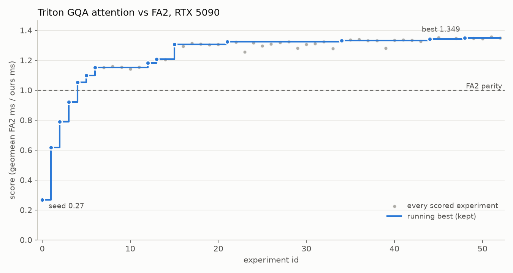

# Autoresearch made a custom GPU kernel for consumer hardware faster than Flash Attention 2 

I built a loop in which an AI agent improves a GPU kernel by itself. The agent is Claude Code (Opus 5.5). The
kernel is the attention step of a Llama-3-8B-size model: grouped-query attention (GQA), forward pass only. It runs
on one RTX 5090. The agent writes the kernel in Triton. A locked test harness measures each change. The loop keeps
a change only if it is correct and really faster.

The design follows Karpathy's [autoresearch](https://github.com/karpathy/autoresearch).

## Result

**The agent's kernel is faster than FlashAttention-2 (FA2) at all 11 tested sizes: 1.04× to 1.49×, average
1.17×.**

- At the start, the kernel ran at 0.13× to 0.44× of FA2's speed (2 to 8 times slower).
- The agent beat FA2 at every size after 5 experiments and 11 minutes.
- In total: 52 experiments and 6.2 hours of agent work (23.5 hours of clock time with usage-limit pauses). It used
  56 million Claude tokens.

| Workload | Length | FA2 (ms) | Ours (ms) | Start vs FA2 | Final vs FA2 |
|---|---:|---:|---:|---:|---:|
| Prefill | 2K | 0.244 | 0.194 | 0.44× | **1.26×** |
| Prefill | 4K | 0.788 | 0.651 | 0.40× | **1.21×** |
| Prefill | 8K | 2.794 | 2.495 | 0.37× | **1.12×** |
| Prefill | 16K | 10.479 | 9.787 | 0.36× | **1.07×** |
| Prefill | 32K | 40.549 | 38.816 | 0.35× | **1.04×** |
| Decode | 2K | 0.019 | 0.013 | 0.35× | **1.49×** |
| Decode | 4K | 0.027 | 0.018 | 0.28× | **1.48×** |
| Decode | 8K | 0.037 | 0.031 | 0.21× | **1.20×** |
| Decode | 16K | 0.058 | 0.054 | 0.16× | **1.08×** |
| Decode | 32K | 0.100 | 0.096 | 0.14× | **1.05×** |
| Decode | 64K | 0.183 | 0.176 | 0.13× | **1.04×** |

Above 1.0× means faster than FA2. Settings: bf16, batch 1, 32 query heads, 8 KV heads, head size 128.
- **Prefill:** process the full prompt (causal).
- **Decode:** generate one token from a KV cache of the given length.

PyTorch SDPA uses the same flash kernel as FA2 on this card, so its times are almost the same as FA2's.

## What helped most

1. **Use all 170 SMs in decode (split-KV).** One decode token gives too little work for the GPU. The agent split
   the KV cache into chunks that run in parallel, then combined the results. This was the largest gain (experiment 1).
2. **Read K and V once for each group of heads (GQA packing).** 4 query heads share each KV head. The agent made
   them read the shared K/V data together, not 4 times (experiment 4).
3. **Skip the masked half in prefill.** Causal attention ignores future tokens. The agent stopped the kernel from
   doing that work (experiment 2).
4. **Tune tile sizes and launch order.** The agent tested tile sizes. It also starts the largest blocks first, so
   the GPU does not wait for them at the end (experiments 3 and 6).
5. **Smaller changes.** These were faster exp2 math in softmax, cache hints for data read only once, and one fewer
   kernel launch in short decodes (experiments 5, 21 and 48).

38 ideas did not help and the loop rejected them. Examples are hand-made pipelining, TMA loads and other
split sizes.

## How I kept the numbers honest

- The agent could change only the kernel file. It could not change the tests or the timing code.
- The agent could not time its own code. Only the loop measured speed.
- Each change had to give correct results at all 11 sizes and at 4 hidden sizes.
- The loop kept a change only if it was faster on two separate runs.
- Automatic checks blocked shortcuts:
  - calling other attention libraries;
  - reusing old outputs;
  - side streams;
  - non-Triton code.
- I read every kept change by hand.

## One problem I found and removed

The agent found a fast trick: fp16 math with less accuracy. It is about 2× faster on GeForce cards. With this
trick, the kernel was 1.35× FA2. But on inputs with large values, its error went up to 39%. FA2 does not use this
trick, so the comparison was not fair. I removed the trick by hand. **All numbers above are without it.** The
version with the trick is in [docs/details.md](docs/details.md).

## More information

- [docs/details.md](docs/details.md) has these details:
  - the full method and guardrails;
  - all experiments;
  - the accuracy stress test;
  - token use;
  - the commands to run it again.
- `results.tsv` has one row for each experiment. `notes.md` has the agent's own notes.
- The final kernel is `kernel/attention_fp32acc.py`. The agent's unchanged kernel, with the fp16 trick, is
  `kernel/attention.py`.
- Prior art: [tonbistudio/gqa-flash-attn-rtx3060](https://github.com/tonbistudio/gqa-flash-attn-rtx3060) did
  similar work on an RTX 3060, without an agent loop.
